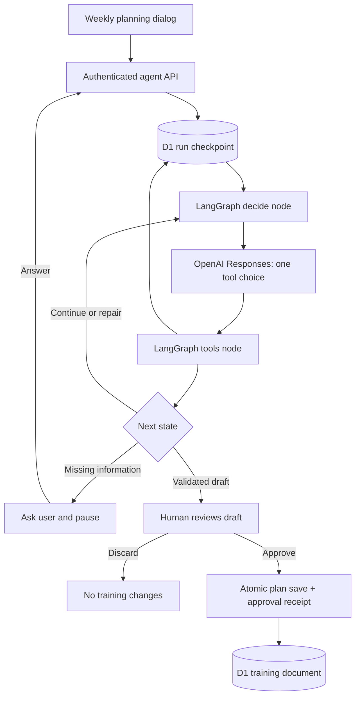

# Momentum: Weekly Training Agent

## One-liner

Momentum helps a consistent-lifting-focused user turn goals and training history into a reviewed weekly program in a mobile web app, replacing manual review of logs and assembly of six sessions; it uses six tools autonomously, asks for missing guidance and approval before saving, and targets an approved usable week in under two minutes in at least 8 of 10 evaluated sessions.

The manual time cost and 8/10 target have not been measured. These are evaluation goals, not achieved claims. The first live draft took 34 seconds; see the validation record for the actual scope tested.

## Project framework

| Field             | Implementation                                                                                                                                                                                                                                    |
| ----------------- | ------------------------------------------------------------------------------------------------------------------------------------------------------------------------------------------------------------------------------------------------- |
| Goal              | Produce one checked, user-approved seven-day training plan grounded in saved preferences and recent logs.                                                                                                                                         |
| Surface           | Momentum's responsive web app, under My week → Plan this week.                                                                                                                                                                                    |
| Steps             | Read goals/history and inspect the catalogue; draft and check; revise or ask for clarification; present the checked draft; save only after explicit approval. The model chooses the next tool rather than following a fixed sequence of prompts.  |
| Memory            | D1 stores profile, plans, logs and chat across sessions, plus run snapshots, model/tool messages, pending tool, call budget, trace and approval status. Run records currently persist indefinitely; a production retention policy is future work. |
| Boundaries        | Never save a plan automatically, replace a started week, infer progress from empty logs, prescribe unsupported load increases, or invent equipment. No medical diagnosis or rehabilitation; exercise suitability still needs human review.        |
| Human involvement | `ask_user` pauses for clarification; the user can answer and resume, discard, or inspect all seven sessions and approve. Approval and its receipt commit together with a revision check.                                                          |
| Failure handling  | A transient model error gets one retry; tool failures and validation errors return to the model. A 12-call cap stops loops; saved progress allows resume; database outages surface an error and cannot authorize a plan write.                    |
| Success measure   | A user approves a personally usable, correctly structured week within two minutes in at least 8/10 sessions, with zero unapproved plan writes. Human review and recorded timing are required to establish this rate.                              |

## Tools and write boundary

| Model tool       | Reads or changes                                                                                                               |
| ---------------- | ------------------------------------------------------------------------------------------------------------------------------ |
| `read_profile`   | Reads the run's saved profile snapshot.                                                                                        |
| `read_history`   | Reads up to 12 completed sessions and three recent plans; checked sets are evidence.                                           |
| `find_exercises` | Reads a curated catalogue filtered conservatively by confirmed equipment.                                                      |
| `check_plan`     | Checks schema, 3/2/1/1 split, duration, location, catalogue names/units, and estimated time; stores a candidate in run memory. |
| `propose_plan`   | Records a previously checked draft and pauses for approval; does not write training.                                           |
| `ask_user`       | Records a question and pauses; resumes after a submitted answer.                                                               |

Checkpoint writes are automatic workflow bookkeeping. The separate human-only `approve` endpoint writes the weekly plan; it is not a model tool. Manual starter plans and single-workout Coach proposals also require deliberate user actions.

## Architecture

The app uses TypeScript and LangGraph, as selected by the builder. One agent, two graph nodes, six tools, two D1 tables; no Python service, vector database, multi-agent hierarchy, or agent hosting service. LangGraph chooses control-flow transitions; the model chooses tool names and arguments.

D1 holds application checkpoints, not LangGraph's native checkpointer. `phase` and `pending` allow resuming before a tool or model decision. Read/check tools are safe to replay. A 90-second lease prevents concurrent executors; a newer lease token rejects an old executor's writes. Model requests time out after 45 seconds. A disconnected request is not a durable background job: the user may need to reopen and resume after lease expiry.

Approval revalidates the draft, checks the source revision and started sessions, then atomically saves the plan and approval receipt. Repeating an approved action is idempotent. All run access is scoped to the authenticated user; writes require the same origin. Raw model messages and training snapshots stay server-side; the UI sees brief tool outcomes, never hidden reasoning or API keys.

## Datasets and prompts

- User-provided profile and workout logs stored in Momentum. No external fitness dataset or scraped Ladder content. Only the bounded recent history is returned to the model.
- A small exercise catalogue derived from the app's authored starter template. This is prototype content, not trainer-validated or clinical programming.
- Synthetic deterministic fixtures in `tests/agent.test.ts` and `tests/agent-d1.mjs` for workflow, validation and persistence. These establish code behavior, not subjective coaching quality.
- Runtime instructions: `lib/coach-prompt.ts` and `lib/agent/model.ts`; tool descriptions and input schemas: `lib/agent/tools.ts` and `lib/coach-schema.ts`.
- OpenAI Responses API, `store: false`, default `gpt-4.1-mini`. This setting disables response storage; it is not a claim of zero provider retention.

No Langfuse dataset or cloud tracing project was created. The in-app trace and local tests are sufficient for this prototype. Future quality evaluation should use a builder-approved set of scenarios, expected outcomes and a human suitability rubric.

## Iterations and observations

1. Momentum originally used a single structured AI request for weekly generation. Replaced the primary generation flow with a model-selected tool loop while preserving logging, progress and supporting Coach chat.
2. Added explicit draft validation and human approval. Testing exposed a starter conditioning session that exceeded its estimate once transitions were counted; shortened its mobility block.
3. Added checkpoints, a bounded retry/call budget, human clarification and conflict protection. Removed the unnecessary save-on-page-load behavior so reopening a draft does not itself invalidate its source revision.
4. The first live run independently encountered a time-budget error, called `check_plan` again with a corrected draft, and reached approval in six model calls. It was discarded; existing training remained unchanged.

A valid JSON response is not a completed workflow. Meaningful tests cover what happens before and after the model call: failed tools, incomplete context, persistence, approval, conflicts and replay. Deterministic checks protect structure; they cannot establish that a workout is appropriate for an individual's condition.

## Remaining submission steps

The local documentation and code are prepared. Copy this write-up into the course's requested Google Doc format, record the demonstration in five minutes or less, and share the code through the required GitHub/submission workflow. No course form, email, Google Doc or GitHub repository has been created or submitted by this update.
